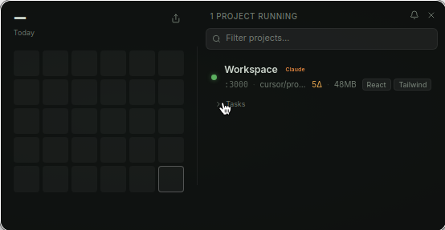

# Localhost Bar

See every dev server you're running, and jump back into it in one click — from the macOS menu bar.



<!--
  The image above is a real capture from `LB_DEMO=1 npm run dev` running in a Linux dev
  environment, so macOS menu-bar vibrancy isn't rendered. Replace it with a macOS screenshot
  or a short GIF of the panel when capturing on a Mac.
-->


## Why it exists

When you run several projects at once — especially AI-assisted ones that spin up dev
servers on whatever port is free — it's easy to lose track of what's running on
`localhost:3000` vs `:5173` vs `:8080`, which branch each is on, and which tool started it.
Localhost Bar sits in your menu bar, auto-discovers those servers, and gives you a one-click
way back into each project.

## Features

Discovered automatically — no config file, no manual registration:

- **Auto-discovery** — scans `localhost` ports (range 1024–9999) every 3 seconds via `lsof`,
  using an allowlist of known dev runtimes (node, bun, deno, python, ruby, …) so system
  services are filtered out.
- **Git status** — branch, uncommitted change count, and last commit per project (cached per
  working directory for 30s).
- **Stack tags** — up to three tags inferred from `package.json` / `pyproject.toml` /
  `Cargo.toml` (framework, DB, UI).
- **AI origin + "Who's coding?"** — per-project badges for the tool that scaffolded a project
  (Cursor, Claude, …) plus detection of AI agents actively working in it.
- **Port-conflict banner** — warns when more than one service is bound to the same port.
- **Quick actions** — open in browser, Finder, your editor, a terminal, or Claude Code; copy
  the `http://localhost:<port>` URL; deploy via the Vercel / Railway / Netlify CLIs; and run
  git commit / pull / create-PR.
- **Project tasks** — a per-project checklist accordion that syncs to AI config files
  (`CLAUDE.md`, `.cursorrules`, …).
- **Stats + heatmap** — daily commit/line stats and an AI token-usage heatmap, shareable to
  the clipboard.
- **Offline tracking** — remembers recently stopped servers with restart / dismiss.
- **Search, pin, and rename** projects, plus online/offline/conflict **notifications** with a
  bell toggle in the header.
- **Auto-update** via `electron-updater` and GitHub releases.

## Two versions

The repo contains two independent implementations of the same idea.

### Electron (`/src`) — the primary app

Electron 34 + [electron-vite](https://electron-vite.org) + React 19 + TypeScript + Tailwind v4,
with `electron-updater` for releases. This is the most complete version and the source of every
feature listed above. See [`.claude/CLAUDE.md`](.claude/CLAUDE.md) for the full architecture map.

### Native Swift / SwiftUI (`/LocalhostBarNative`)

A native rewrite in Swift + SwiftUI ([PR #5](https://github.com/matt-pointon/localhost-bar/pull/5))
that trades breadth for deep macOS integration:

- `MenuBarExtra`-based menu-bar app (`LSUIElement`, no dock icon)
- `lsof`-based port scanning, git status, and quick actions
- Launch at login via the modern `SMAppService` API
- Siri Shortcuts through App Intents ("Show my servers", "Stop server on port 3000", …)
- Localized in English, German, French, and Japanese
- A WidgetKit widget target lives in the source (`LocalhostBarWidget/`) but is currently
  commented out of the XcodeGen build — see [`LocalhostBarNative/project.yml`](LocalhostBarNative/project.yml).

This is the version the CI workflow builds (see below).

## Install

There is **no public release yet.** CI produces **draft** DMGs of the native app on every merge
to `main`, but drafts are only visible to the repo owner, so there is nothing to download at the
moment. Build from source using the steps below.

When a public release does ship, the builds are **unsigned**: macOS will block the app on first
launch, so you'll need to right-click the app and choose **Open** (or allow it under
**System Settings → Privacy & Security**).

## Develop

Requires macOS at runtime — port scanning relies on the macOS `lsof` output format.

### Electron version

```bash
npm install
npm run dev          # dev mode with hot reload
npm run demo:server  # optional: a throwaway server on :3000 so the panel has something to show
npm run build        # production build
npm run dist         # build + package a .dmg (electron-builder)
```

`LB_DEMO=1 npm run dev` keeps the panel open (instead of auto-hiding on blur), which is handy for
screenshots.

### Native version

Requires macOS 14 (Sonoma)+, Xcode (latest-stable / 15+), and
[XcodeGen](https://github.com/yonaskolb/XcodeGen) — the `.xcodeproj` is generated, not checked in.

```bash
brew install xcodegen
cd LocalhostBarNative
xcodegen generate            # writes LocalhostBar.xcodeproj from project.yml
open LocalhostBar.xcodeproj  # then build/run the LocalhostBar scheme in Xcode
```

CI mirrors this flow — `xcodegen generate` followed by `xcodebuild` on `macos-14` — in
[`.github/workflows/build-native-macos.yml`](.github/workflows/build-native-macos.yml).

## Design notes

Localhost Bar is deliberately a small, dense surface, so the visual details carry the feel:

- **8pt grid + crisp retina values** — spacing and sizing were reworked onto an 8-point grid
  ([PR #11](https://github.com/matt-pointon/localhost-bar/pull/11)).
- **Dark glass panel** — a 560×288 frameless, transparent window using macOS `menu` vibrancy and
  rounded corners, positioned just under the tray icon and auto-hidden on blur
  ([`src/main/panel.ts`](src/main/panel.ts)). Colors are defined as OKLCH tokens over a dark
  surface, with Inter for UI text and Poppins for display type
  ([`src/renderer/src/index.css`](src/renderer/src/index.css)).
- **Motion timings** — rows animate in at 200ms and out at 180ms (ease), task and detail
  sections expand at 200ms, and hover states transition at 120ms, so the panel feels responsive
  without being busy ([`src/renderer/src/index.css`](src/renderer/src/index.css)).
- **Template menu-bar icon** — the tray icon is a macOS template image (it auto-inverts for
  light/dark menu bars) with 1x and 2x representations for Retina
  ([`src/main/tray.ts`](src/main/tray.ts)).

The dark-glass UI and git actions landed in [PR #1](https://github.com/matt-pointon/localhost-bar/pull/1).

## License

[MIT](LICENSE) © 2026 Matt Pointon
